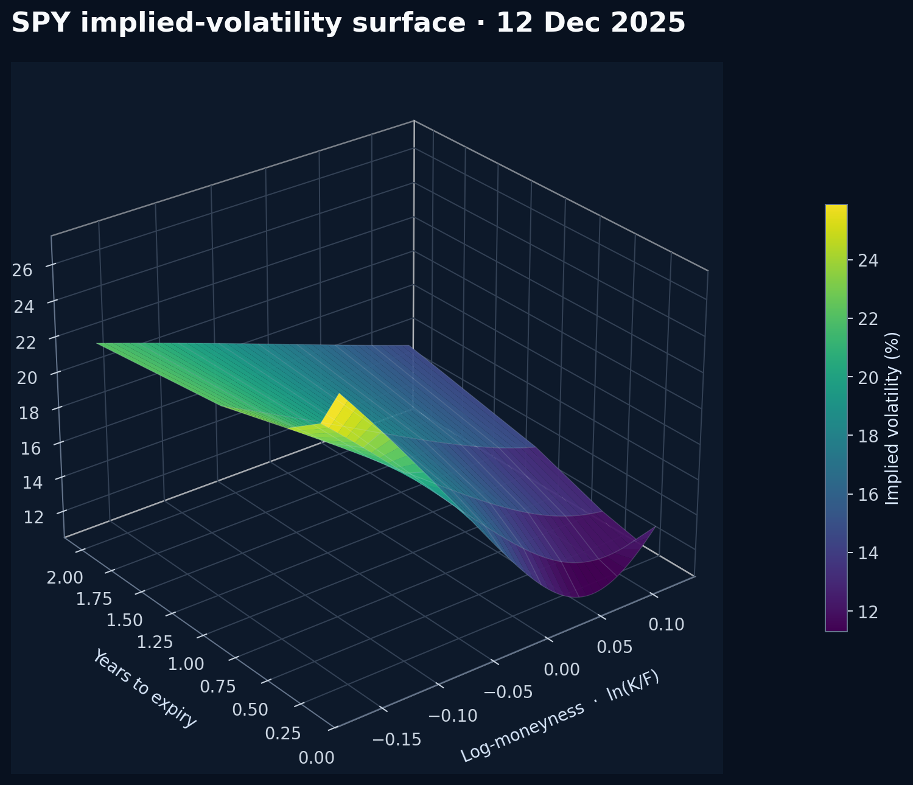
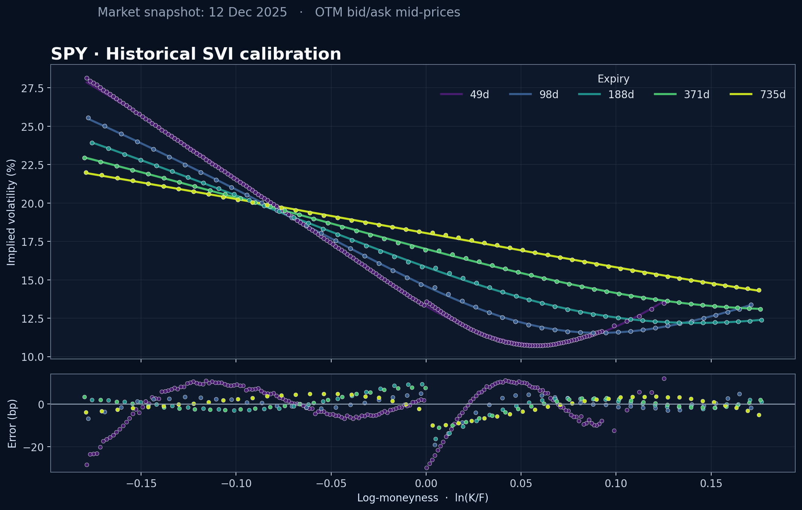

<!-- <div align="center"> -->

# Volatility Surface Calibration
<!-- 
**A real-market SVI calibration in Python**

Historical SPY quotes → put–call parity → Black implied vols → nonlinear SVI fit


 -->

<!-- </div> -->



## What it does

This project calibrates a raw-SVI volatility surface to a **real SPY end-of-day option-chain snapshot from 12 December 2025**.  

<!-- <table>
  <tr>
    <td align="center"><b>SPY 681.76</b><br><sub>historical close</sub></td>
    <td align="center"><b>386</b><br><sub>clean OTM quotes</sub></td>
    <td align="center"><b>5</b><br><sub>expiries</sub></td>
    <td align="center"><b>7.14 bp</b><br><sub>volatility RMSE</sub></td>
  </tr>
</table>

The pipeline: -->

## Outline
1. Loads a historical SPY chain from a public dataset.
2. Infers the forward and discount factor from paired calls and puts.
3. Inverts bid/ask mid-prices to Black implied volatility.
4. Fits one raw-SVI slice per expiry with least squares.

<!-- ## Quick start -->

<!-- ```bash
python -m venv .venv
source .venv/bin/activate          # Windows: .venv\Scripts\activate
pip install -r requirements.txt
python volatility_surface.py
```

The historical snapshot is bundled, so the default run works offline. Outputs are written to:

```text
figures/
├── calibration_diagnostics.png
└── volatility_surface.png
results/
├── calibration.csv          # cleaned quotes, fitted vols, and errors
└── svi_parameters.csv       # a, b, rho, m, sigma by expiry
``` -->

## Calibration quality



Dots are implied volatilities inverted from historical bid/ask mid-prices; solid lines are SVI fits. The lower panel reports errors in volatility basis points.
<!-- 
## Data source

The historical chain comes from the open [Historical Options Dataset mirror](https://github.com/anahatsingh-ui/options-dataset-hist), which contains SPY, QQQ, and IWM end-of-day chains from 2008–2025. The maintained mirror republishes the original dataset by Philipp D. Dubach under the MIT license.

No account, API, or API key is required. The repository includes the filtered snapshot in [`data/spy_options_2025-12-12.csv`](data/spy_options_2025-12-12.csv) and detailed attribution in [`data/SOURCE.md`](data/SOURCE.md).

To reproduce the extraction directly from the public Parquet files:

```bash
python volatility_surface.py --refresh-data
```

DuckDB performs a columnar HTTP query, so it extracts the selected date and expiries without permanently storing the complete yearly archive. -->

<!-- ## Verification

Run the offline regression suite with:

```bash
python -m unittest -v
```

The tests cover Black call–put parity, implied-volatility inversion, historical quote cleaning, calibration accuracy, positive total variance, calendar monotonicity, and the SVI risk-neutral-density condition across the displayed surface. -->

## Model

For log-moneyness $k=\log(K/F_T)$, raw SVI represents total implied variance as

$$
w(k)=a+b\left[\rho(k-m)+\sqrt{(k-m)^2+\sigma^2}\right],
\qquad \sigma_{BS}(k,T)=\sqrt{\frac{w(k)}{T}}.
$$

Each maturity is optimized with `scipy.optimize.least_squares`. The objective is expressed in volatility units, making errors comparable across different expiries, while `soft_l1` loss reduces the influence of noisy quotes.

| Parameter | Interpretation |
|:--|:--|
| `a` | Vertical level of total variance |
| `b` | Overall slope / wing steepness |
| `rho` | Left-right skew, constrained to \((-1, 0]\) for this equity surface |
| `m` | Horizontal smile translation |
| `sigma` | ATM curvature / smoothness |

<!-- ## Use another snapshot

The calibration function accepts any `pandas.DataFrame` containing `expiry`, `log_moneyness`, and `implied_vol`:

```python
from volatility_surface import calibrate_surface, load_historical_quotes

quotes = load_historical_quotes("data/my_snapshot.csv")
parameters, diagnostics = calibrate_surface(quotes)
```

> [!NOTE]
> This is a research example, not a production pricer. Production calibration should additionally enforce static-arbitrage constraints, model American exercise explicitly, and use quote weights derived from vega and bid/ask liquidity.

## License

MIT — use it, modify it, and make the surface your own. -->
